# Tacit

**Sealed-bid auctions and shielded escrow on Zcash. The price is public. The participants are not.**

[](https://github.com/angelraph/tacit/actions/workflows/ci.yml)

**[Try it in 3 minutes](https://tacit-production-6a96.up.railway.app/#/try) (free testnet coins)** · Live: [Mainnet](https://tacit-mainnet.up.railway.app) · [Testnet](https://tacit-production-6a96.up.railway.app) · [Demo video](#demo) · [Mainnet proof](#live-on-zcash-mainnet) · [Protocol](docs/PROTOCOL.md) · [Threat model](docs/THREAT_MODEL.md) · [Release v0.9.0](https://github.com/angelraph/tacit/releases/tag/v0.9.0)

<a id="demo"></a>
[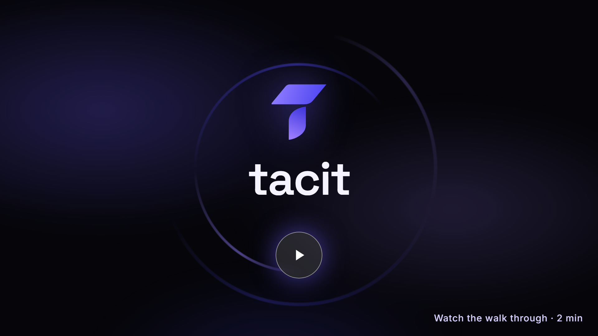](https://tacit-production-6a96.up.railway.app)

Built for the [Zecathon](https://thezecathon.com), Private Markets track.

## At a glance

- **What it is:** a private market on Zcash. Sellers list, bidders seal bids, two independent agents settle, and anyone can audit the result.
- **Sealed bids:** each bid is encrypted to a future [drand](https://drand.love) round and rides inside a shielded memo. Nobody can open it early, and nobody can refuse to reveal.
- **No custodian:** every auction and every escrow gets a fresh 2-of-3 FROST vault on the Ironwood shielded pool. The whole key never exists anywhere.
- **Public audit:** the vault's viewing key is published, so any browser can check the payout to the zatoshi without learning who took part.
- **Runs in your browser:** an Ironwood light wallet compiled to WebAssembly. Keys, syncing and zero-knowledge proofs never leave the tab.
- **Live on mainnet:** two auctions with real ZEC settled on Zcash mainnet and passed the public audit, one with an independent arbiter, so no single party could have moved the funds.
- **Code:** about 9,000 lines of Rust in 7 crates, a 6,000 line web app with no build step, 41 tests, three end-to-end harnesses, and an offline replay of real mainnet and testnet settlements.

## For judges: check it in three minutes

1. **Use it.** Open [Try it](https://tacit-production-6a96.up.railway.app/#/try) on testnet. It walks you from a new wallet to free testnet coins, a sealed bid on the always-open practice lot, and an audit your own browser runs. Every step ticks itself off from what really happened.
2. **See real money.** Two mainnet auctions settled honestly, one of them with an [independent arbiter](#a-mainnet-auction-where-no-party-held-two-keys) so that no party, Tacit included, held two of the vault's three keys. The [mainnet Proof page](https://tacit-mainnet.up.railway.app/#/proof) audits them from public data.
3. **Re-run mainnet offline.** `cargo test -p tacit-core --test conformance` replays that mainnet auction from [test-vectors/](test-vectors/): its terms, both sealed deposits as they sit on chain, and the drand beacon. The settlement rules must reproduce the exact payout the vault made on chain, with no network access.
4. **Read the rules.** [docs/ZIP-DRAFT.md](docs/ZIP-DRAFT.md) specifies the format in the style of a Zcash Improvement Proposal, so any wallet or marketplace can implement it.

## Contents

- [For judges: check it in three minutes](#for-judges-check-it-in-three-minutes)
- [The idea in one minute](#the-idea-in-one-minute)
- [Live on Zcash mainnet](#live-on-zcash-mainnet)
- [Why Tacit](#why-tacit)
- [Product tour](#product-tour)
- [How it works](#how-it-works)
- [The life of a sealed bid](#the-life-of-a-sealed-bid)
- [Architecture](#architecture)
- [Privacy and security](#privacy-and-security)
- [Design and user experience](#design-and-user-experience)
- [Build log](#build-log)
- [Quickstart](#quickstart)
- [Run an agent](#run-an-agent)
- [Repository layout](#repository-layout)
- [Documentation](#documentation)
- [Risks](#risks)
- [License](#license)

## The idea in one minute

On a public chain every bid is visible, so auctions get sniped, bidders get front run and buyers are tracked forever. Zcash hides people, but it has no smart contracts, so fair markets have always needed a middleman who holds the money. Tacit replaces the middleman with three things anyone can check.

| The problem | Tacit's answer | Built on |
|---|---|---|
| Bids leak before the auction ends | Bids are timelock-encrypted to a future beacon round | drand quicknet, tlock |
| Bid sizes leak through deposit amounts | Every bidder deposits the same bond; the real bid is inside the sealed memo | ZIP 302 memos, canonical denominations |
| Someone has to hold the money | A fresh 2-of-3 threshold vault per auction; any two cosign, each recomputes the payout first | FROST (RedPallas), PCZT |
| Nobody can check a private settlement | The vault's viewing key is published; the audit recomputes everything from public data | Ironwood IVK and OVK |
| Bidders are linkable | Shielded deposits, refunds to fresh diversified addresses | Ironwood shielded pool |

## Live on Zcash mainnet

The first Tacit auction with real ZEC: two sealed bids, settled by the agents, audited by the coordinator and by any browser.

| What | Value |
|---|---|
| Auction | `5c5a98387738e2fbd5345f53982e4fc505d4d687a0f3afde2e4c67da791d391c` |
| Sealed bid 1 (0.002 ZEC bond) | `967ec7938963c93c35bbc4813c76fc63ea0db6a287f8ee99326eee763648ed32` |
| Sealed bid 2 (0.002 ZEC bond) | `f572a5d07137c72211eafaa348d4d4a922cc2f1c8cd925c21ba6f434077afadf` |
| Settlement (one shielded payout) | `8d9f0e7040eda2052a8cde555e4c2595ae8decff9c17be47f080da7525bef49c` |
| Settled at block | 3,530,603 |
| Clearing price (second price) | 0.001 ZEC |
| Audit verdict | Settled honestly |

The public mainnet site, [tacit-mainnet.up.railway.app](https://tacit-mainnet.up.railway.app), audits this auction again on its own [Proof page](https://tacit-mainnet.up.railway.app/#/proof), from the published terms and the chain alone, and runs its own operator and arbiter for new mainnet lots.

### A mainnet auction where no party held two keys

The second mainnet lot ran with an **independent arbiter**: a seat run by someone outside the team (donkinz) on their own Windows laptop, using the release binary. The vault's three key shares were held by the seller, the Tacit operator and donkinz, so no single party, Tacit included, could move the funds. The bid was sealed and paid from the Noir browser wallet. At the bell the operator proposed the payout, and donkinz's arbiter recomputed it from the rules and cosigned.

| What | Value |
|---|---|
| Auction | `67c1cc4c48d2dcac17443a5b04e6c84e8eeea2c329a3f1e143da9bb1c76b82a6` |
| Vault seats | seller · Tacit operator · donkinz arbiter (independent) |
| Sealed bid (0.002 ZEC bond, from Noir) | `4e3ba0d20609f625693cc456479679d4818bc2ee164d3d5661df755c9bac2f25` |
| Settlement (one shielded payout, cosigned by donkinz) | `2ba80b68d0596e9a2f4b17708df228b104ff70fb148a9f7b206529872a85250c` |
| Settled at block | 3,534,498 |
| Price | 0.001 ZEC (a lone bidder pays the reserve) |
| Audit verdict | Settled honestly |

What the independent arbiter printed on its own laptop, from joining the vault to cosigning the payout:

```text
arbiter agent "donkinz arbiter" on main
room 86a728b058a7b8361447b92f0e9363ae: dkg
seat 3 of 3; waiting for the other seats...
vault v86a728b058a7 ready: all three seats agree on it
address  u17eqargzxg85qasqd3jhxq9juv3tthhcxpvkwkfxyt9mkwa49qmht0vr33q2sd2mxxm5d2geqg5uvtphyr8fkjqt4wfup06ngcvr57dj4
room ad3aaa9652f183473f903bd1a30db39d: settle:67c1cc4c48d2dcac17443a5b04e6c84e8eeea2c329a3f1e143da9bb1c76b82a6:2
the rules say this auction settles as:
  deposit 252fac9b5c75  bid 0.0015 ZEC
  clearing price 0.001 ZEC, network fee 0.00015 ZEC
  pays        0.001 ZEC  to u1sru3w8rhzmnrqpfs3d55t9...
  pays      0.00085 ZEC  to u10pzw7jr7lwjrz8y3l0yu45...
waiting for seat 2 to send the settlement...
the settlement pays exactly that.
room ad3aaa9652f183473f903bd1a30db39d: cosigned the settlement of 67c1cc4c48d2dcac17443a5b04e6c84e8eeea2c329a3f1e143da9bb1c76b82a6
```

Both mainnet settlements are frozen in [test-vectors/](test-vectors/) and replayed offline by CI.

On testnet, every auction is audited live on the [Proof page](https://tacit-production-6a96.up.railway.app/#/proof). Recent settlements: `179c77a2…a78`, `6f09b98a…613`, `65810dcd…1ff`, `3e1b0e39…cdc`, all settled honestly.

## Why Tacit

**What's new.** Trust-minimized auctions and escrow on a chain with no smart contracts. Threshold signing replaces the contract, timelock encryption replaces the trusted auctioneer, and a published viewing key replaces "trust us".

**Privacy that holds up.** Before the round, nobody learns anything about bids. After it, everyone sees the bids and the price but not who placed them. Deposits are identical in size, refunds go to fresh addresses, and every Tacit transaction is Ironwood-only. The [threat model](docs/THREAT_MODEL.md) spells out what is and isn't private.

**Security by recomputation.** An agent never signs what it is told to sign. It recomputes the settlement from the published terms, the chain and the beacon, checks the transaction pays exactly that, and refuses anything else. The worst a dishonest co-signer can get is a refusal.

**Independent by design.** Agents are open: anyone can run one with two commands. Every agent says who runs it, and the Sell page tells you plainly whether any single party would hold two of a vault's three shares.

**Ready for NU7.** Tacit builds against the NU7 consensus rules that went live on testnet in October, runs its own testnet faucet while the public ones wait for wallet updates, and tracks the mainnet activation at block 3,543,405.

**How it compares.** A sealed auction is only as private as whoever can open it and only as safe as whoever holds the money.

| | Typical online auction | Seller-held sealed bids (the escrow-as-bid design, as in ShieldBid) | Tacit |
|---|---|---|---|
| Who can read bids before the close | The platform, often everyone | The seller, as each payment arrives | Nobody: bids are locked to a future drand round |
| Who holds the money | The platform | The seller alone | A fresh 2-of-3 vault; no single party can move it |
| Can the seller shill or rig after seeing bids | Yes | Yes | No: the seller sees nothing until everyone does |
| Who settles | The platform, by hand | The seller, by hand | Two agents that each recompute the rules, in one transaction |
| Who can check the result | Nobody outside | Each bidder can check their own receipt in the seller's list | Anyone recomputes the whole settlement from the chain and the beacon |
| Bid amounts after the close | Public | Clearing price and ranking published; the seller saw everything | Every bid public, every bidder hidden |
| Number of bids while open | Public | Hidden | Visible to anyone with the terms (sizes and senders stay hidden) |
| Bid from any wallet | n/a | Yes, the amount is the bid | Tacit wallet, Noir extension, or any wallet by QR once the page seals the bid |

**Usable by anyone.** Bid from the Tacit wallet, from the Noir browser extension in one click, or from any mobile wallet by scanning a ZIP 321 payment request. Fund from BTC, ETH, SOL or USDC through NEAR Intents. Install it as an app.

## Product tour

**Landing.** Live prices, chain status, the agents online.

[](media/landing.png)

**Wallet.** A shielded Ironwood wallet in the tab: 12 or 24 words, a QR code, the testnet faucet one tap away.

[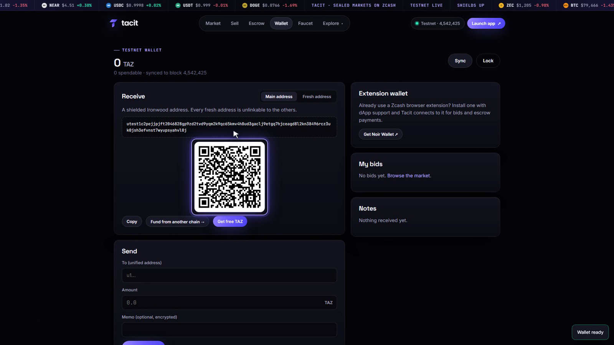](media/wallet.png)

**Sell.** Item, reserve, bond, window and rule. Your browser and two agents generate the vault; the page shows who holds each key share.

[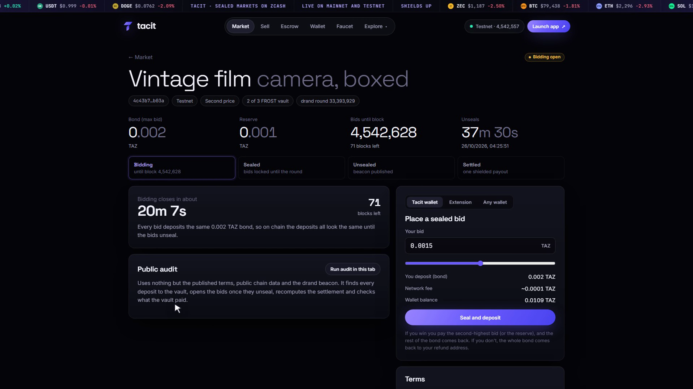](media/sell.png)

**Bid.** The bid is sealed to a drand round and the deposit is proved while you read the confirmation, so sending is instant.

[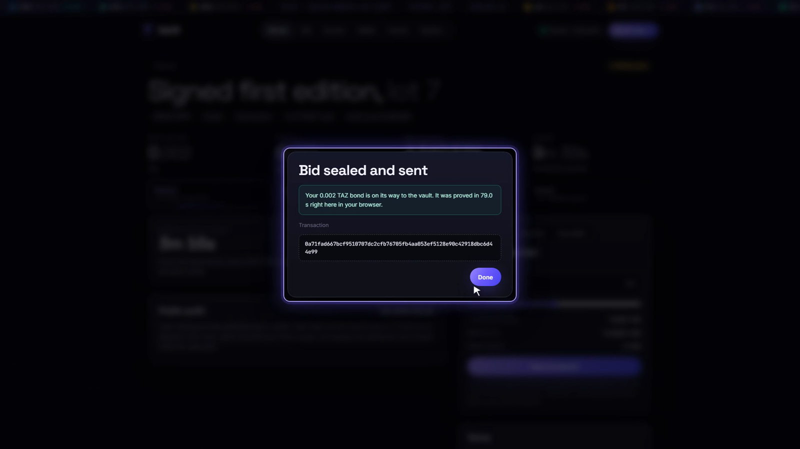](media/bid.png)

**Any wallet.** A ZIP 321 payment request with the sealed bid in its memo, for Zashi, Zingo, YWallet and friends.

[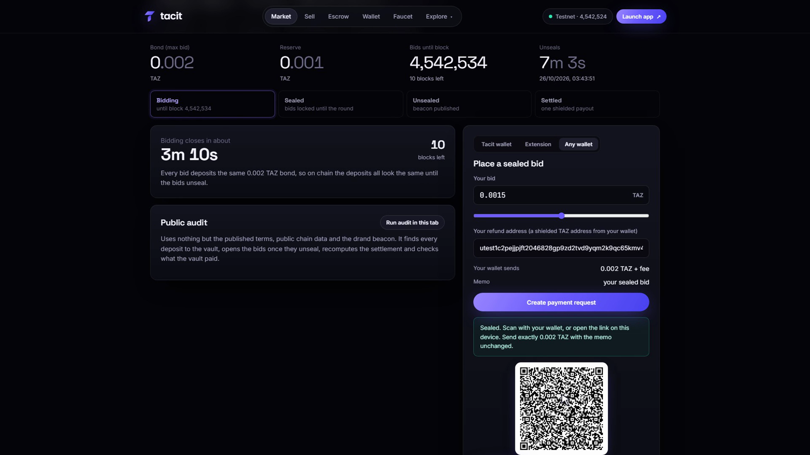](media/ways.png)

**Unseal, settle, audit.** One click recomputes everything and checks the vault paid exactly what the rules require.

[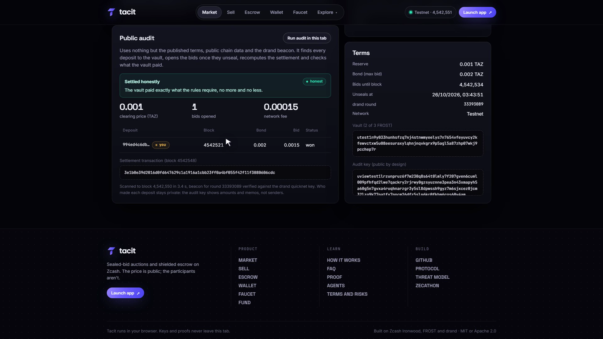](media/settle.png)

**Proof.** Every auction, audited in public. This is mainnet.

[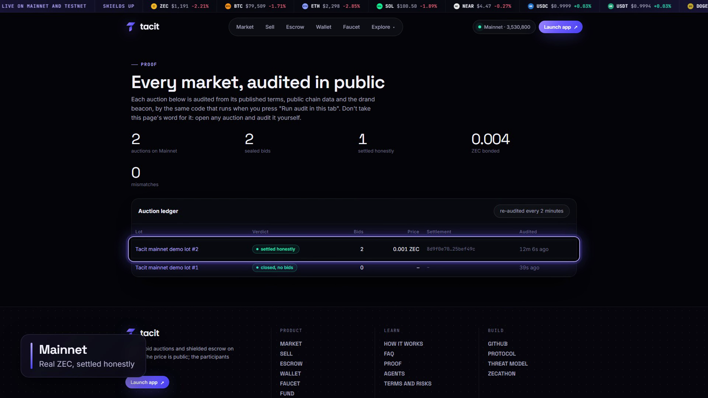](media/proof.png)

**Escrow.** Pay a stranger without trusting them: buyer, seller and an arbiter each hold one share.

[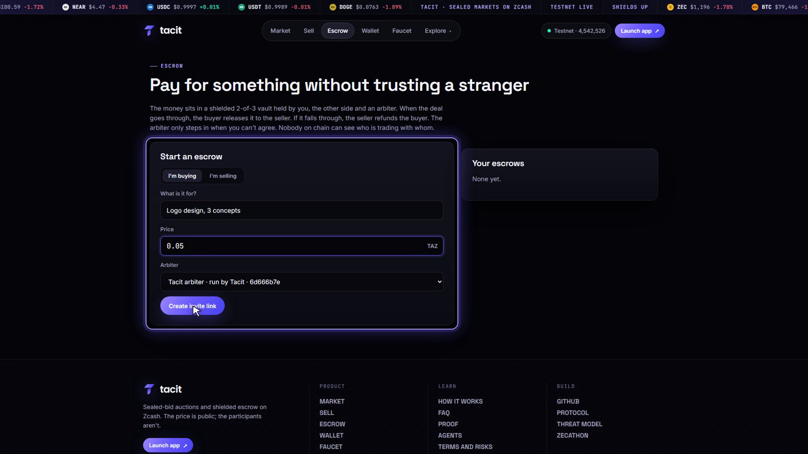](media/escrow.png)

**Agents.** The seats that never sleep, and how to become one.

[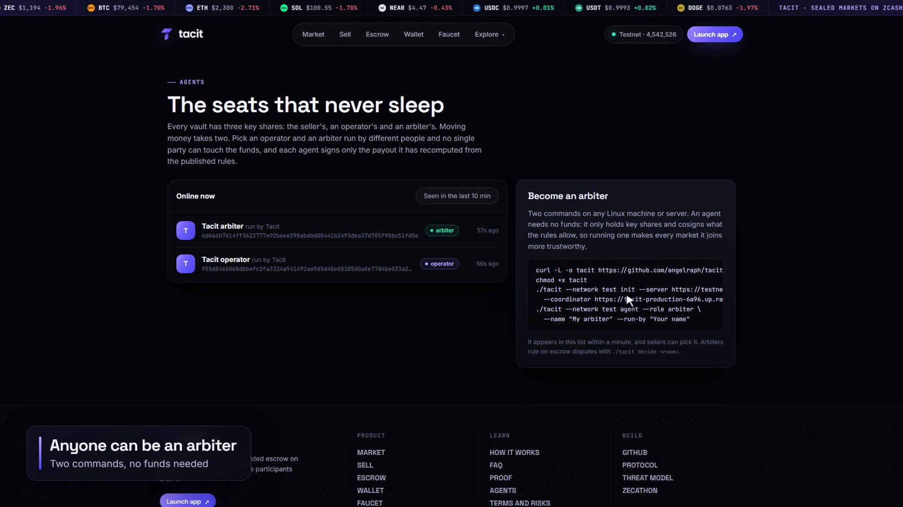](media/agents.png)

## How it works

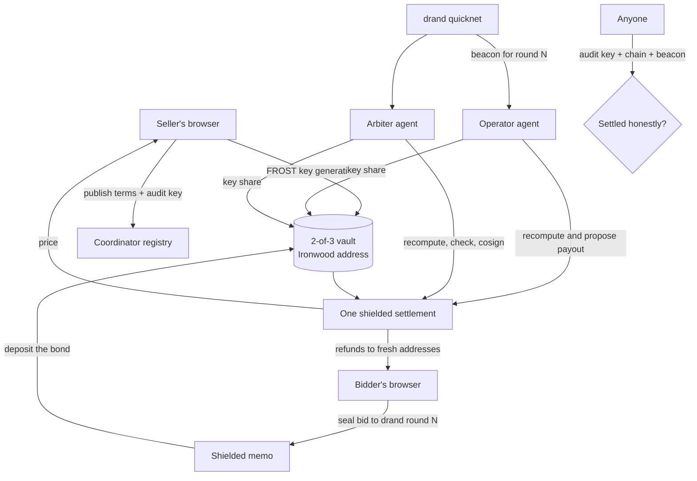

1. **List.** The seller's browser runs FROST distributed key generation with an operator agent and an arbiter agent through sealed envelopes on the coordinator. The terms (item, reserve, bond, bidding height, drand round, price rule, vault viewing key) are hashed into the auction id, so changing any term makes a different auction.
2. **Bid.** The bidder's browser encrypts `{bid, refund address}` to the closing drand round, puts it in a 512 byte memo, and pays exactly the bond into the vault. All deposits look identical.
3. **Unseal.** When drand publishes the round, anyone can open every bid. A bid can't be withheld, because the beacon opens it whether the bidder likes it or not.
4. **Settle.** The operator computes the payout the rules require (first or second price, ties broken deterministically), builds one shielded transaction, and asks the arbiter to cosign. The arbiter recomputes it independently and signs only if it matches.
5. **Audit.** Anyone can rebuild the same result from the terms, the chain and the beacon, and compare it with what the vault paid, using the vault's outgoing viewing key.

## The life of a sealed bid

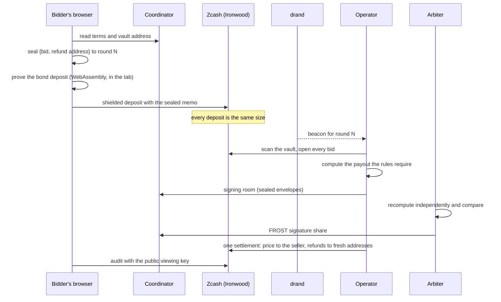

## Architecture

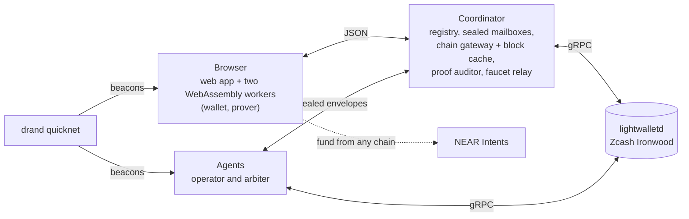

| Component | What it does |
|---|---|
| Web app (`web/`) | The whole product in the browser. No framework and no build step besides the WebAssembly. Installable as an app. |
| Wallet worker | Syncs by trial-decrypting compact blocks, keeps witnesses only for unspent notes, seals bids, runs vault seats, audits. |
| Prover worker | The same code built with threads: proves Ironwood transactions and decrypts long restores on every core. |
| Coordinator | Registry, sealed mailboxes, a JSON chain gateway with a block cache warmed from Ironwood's activation, the proof auditor, and the faucet relay. It never holds a key or sees a readable seat message. |
| Agents | `tacit agent`: always-online vault seats. They join key generation, settle auctions when they unseal, and cosign only what they recompute. |
| CLI | `tacit`: wallet, vaults, auctions, audits, agents and the testnet faucet from the terminal. |

## Privacy and security

| Property | How | Checked by |
|---|---|---|
| Bids unreadable before the close | tlock encryption to a drand round that doesn't exist yet | drand's threshold network; beacon verified in the browser and by agents |
| Deposits reveal no bid sizes | Identical bonds, real bid inside the memo | Audit shows every deposit equals the bond |
| No single party can move funds | FROST 2-of-3; the full key is never assembled | Key generation and signing only through sealed envelopes |
| Payouts follow the rules | Each cosigner recomputes the settlement before signing | Arbiter refuses mismatches; public audit compares with the outgoing viewing key |
| Bidders unlinkable | Ironwood-only transactions, refunds to fresh diversified addresses | Threat model; transactions carry only an Ironwood bundle |
| Coordinator learns nothing private | It relays public chain data and encrypted envelopes; syncing is trial decryption in the browser | Code review; the coordinator has no keys |
| Wallet keys stay local | Phrase and shares encrypted with AES-GCM under a PBKDF2 key from your passcode | Browser storage only |

What isn't private, and what an agent operator could still do, is written out in the [threat model](docs/THREAT_MODEL.md).

## Design and user experience

- One page per job: Market, Sell, Escrow, Wallet, Faucet, Proof, Agents, FAQ. Mobile-first and installable as an app.
- Zero-knowledge proofs start the moment you press "Seal and deposit", so confirming sends instantly.
- One bid at a time; repeated clicks can't clear a proof in flight; plain messages when change is still confirming.
- Restoring an older wallet uses a server-side block cache and decrypts on every core.
- Every auction page audits itself once the bids unseal, and remembers the verdict.
- Live prices, a market table, countdowns tied to block height and drand time, and a timeline from bidding to settled.

## Build log

| Date | Milestone |
|---|---|
| Sep 29 | Sealed bids, drand beacon verification, and a 2-of-3 FROST vault spend on a live Zebra chain |
| Sep 30 | Sealed-bid auctions working end to end on regtest |
| Oct 4 | Browser proving benchmark: Ironwood proofs in about 20 seconds in a tab |
| Oct 5 | Coordinator, sealed seat envelopes, distributed key generation and signing; the `tacit` CLI |
| Oct 24 | Browser wallet, agents, escrow and the web app; one-container deployment |
| Oct 25 | NU7, testnet faucet, Noir and ZIP 321 bidding, installable app; first full testnet auction settled and audited |
| Oct 25 | First mainnet auction with real ZEC settled and audited |
| Oct 25 | Block cache, multi-core restores, Proof page, independent agent identities |
| Oct 26 | No-bids verdict, resilient connections, release v0.9.0 |

## Quickstart

Use it: open the [live app](https://tacit-production-6a96.up.railway.app), create a wallet, press **Get free TAZ** on the Faucet page, and bid on an open auction.

Run it locally on a Zebra regtest chain. You need Rust, Python 3 and Zebra 6.4+ (`tacit-dev init` writes its config). Building the WebAssembly needs clang and wasm-bindgen-cli 0.2.129; on Windows, run `web/build.sh` in WSL.

```bash
# chain, block clock and coordinator with its chain gateway
cargo run -p tacit-wallet --bin tacit-dev -- mine-every 20
cargo run -p tacit-coordinator -- 127.0.0.1:8650 coordinator.sqlite http://127.0.0.1:9067

# an operator and an arbiter agent, each with its own home
cargo run -p tacit-cli -- --home ./operator init
cargo run -p tacit-cli -- --home ./operator agent --role operator --name "Operator" --run-by "You"
cargo run -p tacit-cli -- --home ./arbiter init
cargo run -p tacit-cli -- --home ./arbiter agent --role arbiter --name "Arbiter" --run-by "A friend"

# the web app
sh web/build.sh
python web/serve.py 8770        # then open http://127.0.0.1:8770
```

Fund a browser wallet with `cargo run -p tacit-wallet --bin tacit-dev -- fund <address> <zatoshi>`.

End-to-end checks:

```bash
cargo run -p tacit-wallet --bin tacit-dev -- auction-e2e      # a full sealed-bid auction, natively
cargo run -p tacit-wallet --bin tacit-dev -- light-e2e        # the browser wallet's code paths
cargo run -p tacit-wallet --bin tacit-dev -- scan-check <gateway> <auction id>   # audit a live auction
```

## Run an agent

Anyone can be an arbiter. It needs no funds: it only holds key shares and cosigns what the rules allow.

```bash
curl -L -o tacit https://github.com/angelraph/tacit/releases/latest/download/tacit-linux-x86_64
chmod +x tacit
./tacit --network test init --server https://testnet.zec.rocks:443 \
  --coordinator https://tacit-production-6a96.up.railway.app
./tacit --network test agent --role arbiter --name "My arbiter" --run-by "Your name"
```

It shows up on the [Agents page](https://tacit-production-6a96.up.railway.app/#/agents) within a minute, and sellers can pick it.

On Windows, in Command Prompt or PowerShell (one line at a time):

```bat
curl -L -o tacit.exe https://github.com/angelraph/tacit/releases/latest/download/tacit-windows-x86_64.exe
.\tacit.exe --network main init --server https://zec.rocks:443 --coordinator https://tacit-mainnet.up.railway.app
.\tacit.exe --network main agent --role arbiter --name "My arbiter" --run-by "Your name"
```

On mainnet, point it at the mainnet site instead:

```bash
./tacit --network main init --server https://zec.rocks:443 \
  --coordinator https://tacit-mainnet.up.railway.app
./tacit --network main agent --role arbiter --name "My arbiter" --run-by "Your name"
```

## Repository layout

```text
crates/
  tacit-core/          auction and escrow rules, sealed-bid memos, drand beacon, seat envelopes
  tacit-vault/         FROST vaults: key generation and signing as message-passing state machines
  tacit-light/         the browser wallet: compact block scanning, witnesses, payments, audits
  tacit-wasm/          tacit-light and vault seats compiled to WebAssembly
  tacit-wallet/        the native wallet on librustzcash, coordinator client, tacit-dev harnesses
  tacit-coordinator/   registry, mailboxes, chain gateway with block cache, proof auditor
  tacit-cli/           the tacit command: wallet, vaults, auctions, agents, faucet
web/                   the web app (ES modules, WebAssembly workers, PWA)
deploy/                one-container deployment: coordinator, agents and faucet
demo/                  the scripted demo video: scenes, motion graphics, voice-over, assembly
docs/                  protocol, threat model, demo script
media/                 screenshots
vendor/zcash_protocol/ zcash_protocol with the NU7 activation heights
```

## Documentation

| Document | What's in it |
|---|---|
| [docs/ZIP-DRAFT.md](docs/ZIP-DRAFT.md) | The format as a draft Zcash Improvement Proposal, with requirements, rationale and security considerations |
| [docs/PROTOCOL.md](docs/PROTOCOL.md) | The exact rules: terms, memo format, settlement, escrow |
| [test-vectors/](test-vectors/) | Real settled auctions frozen from mainnet and testnet; `cargo test -p tacit-core --test conformance` replays them |
| [docs/THREAT_MODEL.md](docs/THREAT_MODEL.md) | What is private, what isn't, and what each party could do |
| [docs/DEMO_SCRIPT.md](docs/DEMO_SCRIPT.md) | The walk through, scene by scene |
| [docs/DEMO_TRANSCRIPT.md](docs/DEMO_TRANSCRIPT.md) | The 2-minute demo's narration with timestamps; captions in [media/tacit-demo-2min.srt](media/tacit-demo-2min.srt) |
| [demo/](demo/) | How the demo video is recorded and assembled |

## Risks

- New code that holds money. Start with amounts you can afford to lose.
- An operator and an arbiter run by the same party could move a vault together. Tacit shows who runs each agent and warns when that would happen; pick independent agents, or run one.
- drand's threshold network is trusted not to publish a round early.
- The coordinator can see when you connect and can delay or drop messages. It can't read seat messages or move funds.
- Funding from another chain through NEAR Intents is public on that chain.
- Mainnet NU7 activates at block 3,543,405; Tacit builds against those rules.

## License

MIT or Apache 2.0, at your option.
